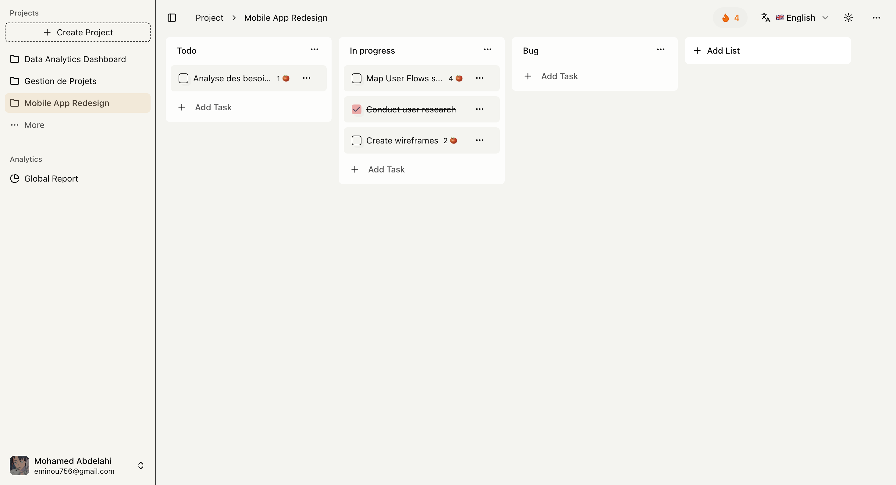

# GoalFlow

A free productivity app that combines Kanban boards, task-level Pomodoro timers, daily streaks, and activity reports. Built with Next.js, React, TypeScript, and PostgreSQL.



## Features

- Organize projects into columns and reorder tasks with drag and drop.
- Focus with configurable work sessions, short breaks, and long breaks.
- Review focus time, completion counts, activity heatmaps, and project comparisons.
- Sign in with GitHub or Google through Better Auth.
- Use English, French, or Arabic, including right-to-left layouts and light/dark themes.

All features are available without subscriptions or payments.

## Local setup

Use Node.js 24 LTS, pnpm 11, and a Neon PostgreSQL database. The runtime uses the Neon WebSocket adapter; a plain local PostgreSQL server needs a compatible proxy or a different Prisma adapter.

```sh
pnpm install --frozen-lockfile
cp .env.example .env
# Fill in the database URL, a random auth secret, and your OAuth credentials.
pnpm db:generate
pnpm db:migrate
pnpm dev
```

Open http://localhost:3000. Configure OAuth callbacks for `/api/auth/callback/github` and `/api/auth/callback/google` on the same origin as `BETTER_AUTH_URL`.

## Project structure

```text
src/app/          Routes, layouts, and providers
src/features/     Domain modules: project, column, task, pomodoro, report, streak
  <feature>/
    actions/      Server entry points
    components/   Feature UI
    hooks/        Client behavior, where needed
    types/        Domain types and input schemas
src/server/       Server-only ownership checks
src/components/   Shared UI primitives and application navigation
src/lib/          Database, authentication, and shared utilities
prisma/           Schema and versioned migrations
tests/            Ownership and timer regression tests
```

## Validation

```sh
pnpm lint
pnpm typecheck
pnpm test
pnpm format:check
pnpm build
```

Generate the Prisma client before type checking on a fresh checkout. Unit tests mock external services and do not require production credentials. They do not replace a full browser and database integration test.

`pnpm build` only builds the application. Apply database migrations separately with `pnpm db:migrate` during deployment.

## Architecture and maintenance

See [architecture notes](docs/architecture.md) for ownership boundaries, timer concurrency, and database compatibility. Analytics are optional and disabled when their environment key is absent.

### Guest access

On the sign-in page, choose **Try as a guest**. Each visitor gets a separate Better Auth anonymous identity with the same project ownership checks as registered users. Signing in with Google or GitHub transfers that guest’s projects and focus history to the authenticated account. Signing out loses access to an unlinked guest workspace; it does not share it with other visitors.

Deploy the additive `20261109000100_guest_access` migration before deploying this feature. The guest endpoints require the configured `BETTER_AUTH_URL` Origin. Anonymous sign-in is limited to five requests per minute per instance/IP by Better Auth.
